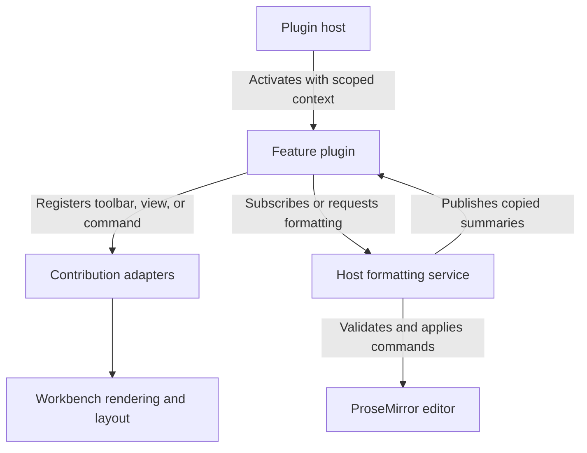

# Building a Writer's IDE plugin

A plugin adds a feature to Writer's IDE without taking over the workbench or reaching into editor internals. It can contribute an interface, observe the state it needs, and ask the host to perform supported actions.

For example, the built-in formatting plugin contributes a toolbar. It receives information such as “half the selected text is bold” and can request “toggle bold.” It does not need to receive the selected text, a ProseMirror editor, or the application's workspace state.

**Current scope:** this private workspace package supports trusted, bundled plugins. There is no external installation, sandbox, or plugin-management UI yet. The APIs are evolving, not a stable published SDK. Capability checks restrict calls through the host, but do not contain in-process JavaScript.

## What can a plugin do today?

Plugins declare the capabilities they use in their manifest. Each capability has a corresponding API on the context supplied during activation.

| I want to…                      | Declare this capability | Use this API                         | What it gives you                                                                                         |
| ------------------------------- | ----------------------- | ------------------------------------ | --------------------------------------------------------------------------------------------------------- |
| Add a movable toolbar item      | `contributions.toolbar` | `context.contributions.toolbar(...)` | Horizontal and vertical presentations; the workbench handles placement, dragging, and capacity.           |
| Provide a central view          | `contributions.view`    | `context.contributions.view(...)`    | Registers a view type that the host can place in the central workspace.                                   |
| Provide an action               | `contributions.command` | `context.contributions.command(...)` | Registers a named action that host code can invoke without depending on your implementation.              |
| Follow active-editor formatting | `formatting.observe`    | `context.formatting.subscribe(...)`  | Immediate and subsequent formatting summaries, including mixed-selection ratios and command availability. |
| Change active-editor formatting | `formatting.execute`    | `context.formatting.execute(...)`    | Requests a supported change against a particular view and state revision.                                 |

Contributions and data access are separate. Registering a toolbar does not grant formatting access, and observing formatting does not grant editing authority. Declare only what the feature uses. Missing observation/registration capabilities cause an error; unauthorized formatting execution returns `false`.

The current view API registers a presentation, not a complete document-view integration: it has no instance metadata or plugin-facing “open view” operation yet. Command registration does not create a keyboard binding, menu item, or command palette entry automatically.

There are no public plugin APIs yet for reading manuscript text, arbitrary document edits, project storage, history trees, assets, network requests, filesystem access, or native execution. An undo-tree plugin, for example, needs a future host history service; it cannot be built from the current formatting API.

## How the pieces fit together

There are three layers:

1. **Your plugin** describes a feature and uses the context it receives.
2. **The plugin host** owns activation, capabilities, registrations, and cleanup.
3. **Application adapters and services** connect those requests to the existing workbench and ProseMirror editor.



The workbench owns where a toolbar lives; the plugin owns what its controls do. The formatting service owns editor transactions, active-view resolution, and focus restoration; the plugin supplies a command request. This division keeps feature code smaller and gives the host one place to enforce shared rules.

The package exports **contracts**, not the application host implementation:

- `@writers-ide/plugins`: framework-independent data, capability, contribution, and lifecycle types.
- `@writers-ide/plugins/svelte`: the current trusted Svelte presentation adapter types.

A ProseMirror `Plugin` is a different concept: it extends an editor internally. It is not an application-plugin lifecycle or a security boundary.

## Add a toolbar

A bundled plugin exports a manifest and a synchronous `activate(context)` function. The manifest identifies the feature, names its capabilities, and declares the host API version it expects. Currently, only `apiVersion: 1` is supported.

Here is a small plugin definition, assuming `FormattingToolbar.svelte` is the component shown in the next section:

```ts
import type { SveltePlugin } from '@writers-ide/plugins/svelte';
import FormattingToolbar from './FormattingToolbar.svelte';

export const plugin: SveltePlugin = {
	manifest: {
		id: 'example.formatting',
		version: '0.1.0',
		apiVersion: 1,
		name: 'Formatting tools',
		description: 'A toolbar for basic text formatting.',
		capabilities: ['contributions.toolbar', 'formatting.observe', 'formatting.execute'],
	},
	activate(context) {
		const presentation = { component: FormattingToolbar, context };
		context.contributions.toolbar({
			id: 'example.formatting/toolbar',
			name: 'Formatting tools',
			horizontal: { presentation, size: 1 },
			vertical: { presentation, size: 1 },
		});
	},
};
```

Each orientation can use a different component and cost **1, 2, or 3 logical capacity units**. A bar holds at most three units; these are layout costs, not a pixel-size guarantee. This example shares one component between orientations; the built-in plugin provides separate presentations.

Use stable, plugin-qualified contribution IDs. IDs must be unique within each contribution kind across active plugins; they are not automatically prefixed. Registering a toolbar makes it available to the workbench; it does not choose its initial placement.

The descriptor `{ component, context }` tells the trusted adapter what to render and which activation's services it can use. Components receive a `context` prop, not the legacy editor/workspace props. Svelte is the current bundled rendering adapter, not a requirement selected for all future third-party interfaces.

## Observe state, then request an action

A formatting component subscribes to the latest summary and uses that summary when issuing a command:

```svelte
<script lang="ts">
	import type { FormattingSnapshot } from '@writers-ide/plugins';
	import type { SveltePluginContext } from '@writers-ide/plugins/svelte';

	let { context }: { context: SveltePluginContext } = $props();
	let formatting = $state<FormattingSnapshot | null>(null);

	$effect(() => {
		return context.formatting.subscribe((snapshot) => {
			formatting = snapshot;
		});
	});

	function toggleBold() {
		if (!formatting?.enabled.bold) {
			return;
		}
		context.formatting.execute({
			viewId: formatting.viewId,
			revision: formatting.revision,
			command: 'bold',
		});
	}
</script>

<button disabled={!formatting?.enabled.bold} onclick={toggleBold}>Toggle bold</button>
```

`subscribe()` delivers a snapshot immediately, or `null` when no supported editor is active. Later notifications follow editor and active-view changes. Each subscriber receives its own data copy.

| Snapshot field | How to use it                                                                                                                                                                                         |
| -------------- | ----------------------------------------------------------------------------------------------------------------------------------------------------------------------------------------------------- |
| `viewId`       | Identifies the editor view the summary describes. Treat it as opaque; it is not a document ID.                                                                                                        |
| `revision`     | An opaque, in-memory state token. Send it back with the command; it is not a saved document version.                                                                                                  |
| `marks`        | Ratios for bold, italic, superscript, subscript, underline, overline, and strikethrough. `0` means absent, `1` means present throughout selected text, and intermediate values mean mixed formatting. |
| `blocks`       | Paragraph-formatting indicators. Alignment values are coverage ratios; `indent` is indentation relative to the maximum, and `dedent` is its complement when paragraphs are available.                 |
| `enabled`      | Whether each formatting command is currently available. Use it to disable controls rather than guessing from visual state.                                                                            |

Commands are the seven mark names above, `indent`, `dedent`, `align-left`, `align-center`, `align-right`, and `align-justify`.

`execute()` returns `false` if the request is stale, the target is no longer active, the command is unavailable, or the plugin's authority has been revoked. **Do not retry a stale action against whichever editor happens to be active next.** Wait for a fresh snapshot and a new user action. This prevents delayed interactions from editing the wrong view or selection.

The service retains existing editor behavior: mark toggles require a nonempty selection, superscript/subscript exclude each other, and paragraph operations account for pagination-created continuations. A plugin does not need to reproduce those rules.

## Activation, cleanup, and moving UI

Registration is not activation. The host calls `activate()` when enabling a plugin; it may return a cleanup function. Activation is synchronous in this phase.

- Contribution registrations and formatting subscriptions return cleanup handles and are automatically owned by the activation.
- For component subscriptions, also return the handle from a Svelte effect, as above. Moving a toolbar can unmount its presentation without disabling the plugin.
- Use `context.own(dispose)` for additional resources, such as timers or event listeners. Its returned handle lets you release them early.
- Use `context.signal` to cancel work when the activation ends. It does not move work off the main thread or make asynchronous activation supported.

Keep meaningful feature state outside component-local presentation state when it must survive relocation. The formatting example simply resubscribes to the current host summary after remounting. There is no general plugin-state persistence API yet.

On deactivation, the host first revokes the context and aborts its signal, then cleans up owned resources in reverse order. On activation failure, it rolls back registered resources. Cleanup handles are idempotent, and a failed disposer does not prevent other cleanup. Old command handles cannot regain authority when the plugin is enabled again.

Disabling a toolbar preserves its in-memory placement and capacity costs, but removes its presentation. It does not delete project data. The current host does not provide durable project recovery or layout storage.

## Connecting a plugin to the application

This is host integration work, not something the plugin performs itself. The application currently imports bundled definitions explicitly; nothing scans directories or executes project-supplied code.

[`createApplicationPluginHost()`](../../src/lib/plugins/application-plugin-host.ts) supplies the workbench registries and formatting service to [`PluginHost`](../../src/lib/plugins/plugin-host.ts). Host code calls `register(plugin)`, then `activate(plugin.manifest.id)`, and calls `deactivate(id)` during teardown or disabling. See the [application bootstrap](../../src/routes/+page.svelte) for the working integration.

Host management uses `get(id)` or `list()` to inspect copied metadata, contribution IDs, status, and errors. Check the result of activation: activation/cleanup failures are recorded in `errors`, while invalid registrations and lifecycle calls throw. Re-enabling or retrying uses `activate(id)` again. There is no reactive management subscription or persisted enable/disable preference yet.

For another host integration, implement `ContributionRegistry.register(ownerId, contribution)` adapters that return removal handles, and supply a `FormattingService`. Adapter registration and subscription setup must undo partial work if they throw; the generic host cannot repair an external service that fails before returning a cleanup handle.

## Read next

- [Built-in formatting plugin](../../src/lib/editor/prosemirror/menu/basic/menu.ts): real registration and orientation-specific components.
- [Type definitions](index.ts) and [Svelte adapter](svelte.ts): exact API signatures, rather than a second copy of the interfaces here.
- [Plugin architecture and stages](../../docs/plugins/context.md): current boundaries, limitations, and the planned manager/library and isolation work.

The long-term boundary is the same—features contribute through explicit APIs—but isolated third-party rendering, messaging, and permission grants still require Stage 3 implementation. A direct Svelte mount and a capability declaration are not a sandbox.
